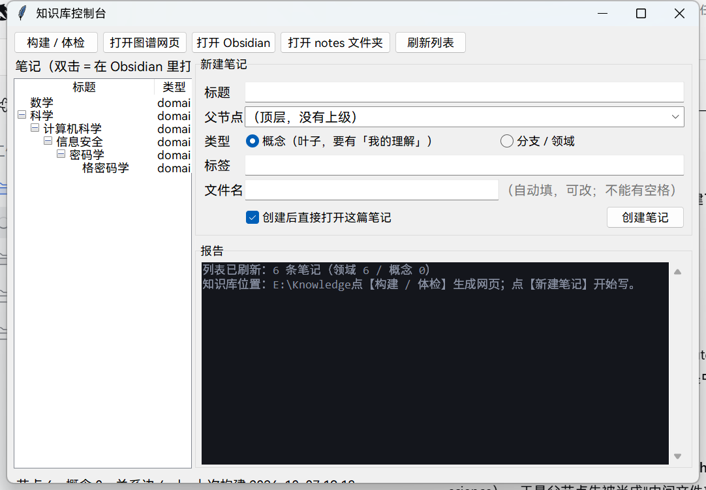
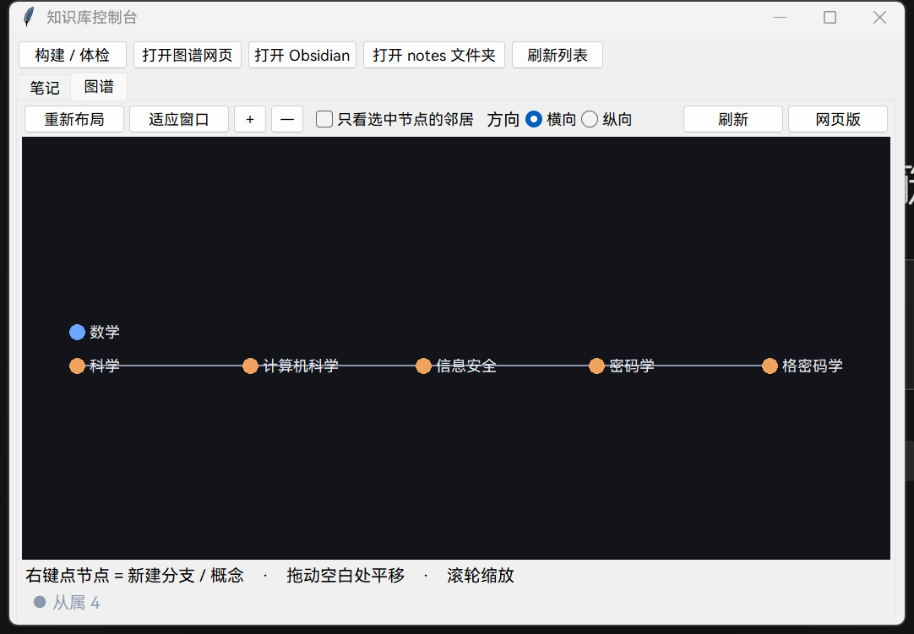
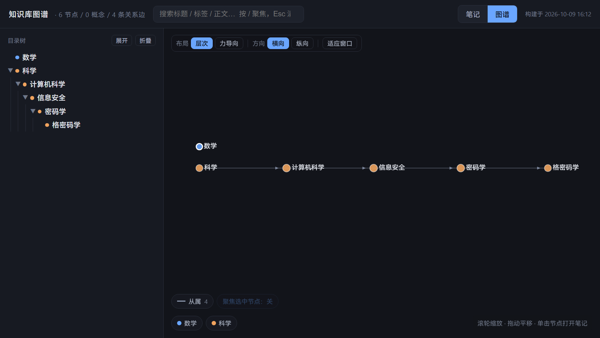

# 知识库操作指南

> **本文件位置**：`docs\操作指南.md`（不参与构建，只供你查阅）
> **版本基准**：2026-10-03，以 `tools/build.py`、`tools/new.py`、`kb.config.yml` 的**实际行为**为准
> **阅读建议**：第一次只读 §1 §2 §3，半小时内能跑通；其余按需查

**一句话心智模型**：你在 `notes\` 里写 Markdown（用 Obsidian）→ 点一下【构建】或跑一条命令 → `out\index.html` 变成可交互的知识图谱网页。

**`notes\` 是资产，`out\` 是耗材。**

---

## 目录

- [§0 图形界面（不想碰命令行就用这个）](#§0-图形界面不想碰命令行就用这个)
- [§1 环境准备（只做一次）](#§1-环境准备只做一次)
- [§2 目录职责](#§2-目录职责)
- [§3 快速上手（15 分钟跑通全流程）](#§3-快速上手15-分钟跑通全流程)
- [§4 四种"新建"操作](#§4-四种新建操作)
- [§5 frontmatter 字段参考](#§5-frontmatter-字段参考)
- [§6 关系语法参考（核心）](#§6-关系语法参考核心)
- [§7 笔记正文结构约定](#§7-笔记正文结构约定)
- [§8 构建与报告解读](#§8-构建与报告解读)
- [§9 网页怎么用](#§9-网页怎么用outindexhtml)
- [§10 思维导图（可选）](#§10-思维导图可选)
- [§11 维护](#§11-维护)
- [§12 故障排查](#§12-故障排查)
- [§13 已知文档笔误](#§13-已知文档笔误)

---

## §0 图形界面（不想碰命令行就用这个）

**启动方式（三选一）**

- 双击桌面上的 **「知识库」** 快捷方式；
- 双击仓库根目录的 **`启动知识库.bat`**；
- 直接双击 **`tools\gui.pyw`**。

（三者都是打开同一个窗口，不会留下黑色命令行窗口。）

> **关于桌面快捷方式的图标**：图标文件放在 `%LOCALAPPDATA%\Knowledge\kb.ico`，**不是**仓库内的 `tools\kb.ico`。
> 原因：`E:\Knowledge` 这棵目录树的 ACL 被沙箱改造过，Windows 从快捷方式提取图标时用的是沙箱化的提取进程，读不到库内的图标 → 只会显示默认白纸；放到用户目录下就正常。
> 图标的**源文件仍在仓库里**（`tools\kb.ico`，由 `tools\make_icon.py` 生成，已进 git）。
> 想重建快捷方式（换了机器、快捷方式被删、图标变白纸）：双击仓库根目录的 **`创建桌面快捷方式.bat`**，或运行 `python tools\install_shortcut.py [--name 名字]`。



**界面上的按钮**

| 按钮 | 等价命令 | 说明 |
|---|---|---|
| 构建 / 体检 | `python tools/build.py` | 报告直接显示在下方：警告黄色、错误红色、「全部通过」绿色；同时刷新 `out\index.html` |
| 打开图谱网页 | — | 用浏览器打开 `out\index.html`；没构建过会提示先构建 |
| 打开 Obsidian | — | 打开整个库；**先在左侧选中某条笔记再点，就直接打开那一篇** |
| 打开 notes 文件夹 | — | 用资源管理器打开，想自己翻文件时用 |
| 刷新列表 | — | 在 Obsidian 里新建/改名/删除后点一下，重新读一遍 `notes\` |

**新建笔记表单**（等价于 `python tools/new.py`）

1. 填**标题** → 「文件名」自动生成（可改，**不能有空格**；中文可以直接用）；
2. **父节点**下拉里选上级（只有 `type: domain` 的笔记会出现在这里；选「（顶层，没有上级）」就是顶层领域）；
3. **类型**：`概念（叶子，要有「我的理解」）` 或 `分支 / 领域`；
4. **标签**逗号分隔（可留空）；
5. 点【创建笔记】。勾着「创建后直接打开这篇笔记」的话，它会自动在 Obsidian 里打开这篇、并顺手重新构建一次。

**左侧笔记树**：双击任意一条 = 在 Obsidian 里打开它。

**注意**

- 界面**只调用 `build.py` 和 `new.py`**，不会直接改动你的笔记内容；**删除、改名、写正文仍然在 Obsidian（或资源管理器）里做**；
- 界面里跑的是普通体检（有警告不拦）；想要"有警告就失败"的严格模式，仍然用命令行 `python tools\build.py --strict`；
- 界面本身不需要装任何第三方库（Python 自带 tkinter）；但**子进程用的是你 PATH 上的 `python`**，所以 §1.2 的 PyYAML 依然是前提。

### 0.2 「图谱」页（直观地在图上操作）



窗口上方有两个标签页：**笔记**（上一节的列表与表单）和**图谱**（把 `out\graph.json` 画成图）。

| 操作 | 效果 |
|---|---|
| **右键点节点** | 弹出菜单：**在此节点下新建分支…** / **在此节点下新建概念…** / 在 Obsidian 里打开 / 在「笔记」列表里定位 / 只看它和邻居 / 复制节点 id / 在网页版里打开（聚焦它） |
| **右键点空白** | 新建顶层领域… / 重新布局 / 适应窗口 / 刷新数据 |
| 左键点节点 | 选中（白圈高亮），底部显示：上级、下级、关系类型、id |
| 左键双击节点 | 在 Obsidian 里打开这篇笔记 |
| 拖动空白处 / 滚轮 | 平移 / 缩放 |
| 重新布局 · 适应窗口 | 重排层次 · 让整张图回到窗口中央 |
| 方向：横向 / 纵向 | 树是横着长还是竖着长 |
| 只看选中节点的邻居 | 聚焦模式：只显示选中节点与它的直接关联 |
| 刷新 | 重新读 `out\graph.json`（在外部改过笔记后点它） |
| 网页版 | 打开 `out\index.html`（功能更全：全文搜索、正文阅读、公式渲染、力导向图） |

**图的含义**：点的颜色 = 顶层领域；实线 = 从属（由文件夹层级推导）；其他颜色/线型 = `kb.config.yml` 里定义的关系类型（底部图例标出每种的条数）。

**右键新建的流程**：弹窗里填 **标题**（显示名，中文即可）与 **文件名**（id 用的短名，建议英文，例如 `infosec`），还能顺手填标签、选类型 →
自动调 `new.py` 建文件 → 自动构建 → 图谱刷新并把新节点选中居中。
文件名会随标题自动填一次；你把它改成英文后，再改标题也不会覆盖它。这样就能得到 `infosec.md` + `title: 信息安全` 这种"文件名短、标题好看"的效果。也就是说，"看图 → 在图上点出下一步"这一整套都不用碰命令行。

> 这是个轻量视图：布局是**层次树**（父在左、子在右），不是网页版那种力导向；节点数在**几百个以内**都很流畅，上千会明显变慢——那种规模就用【网页版】。


---

## §1 环境准备（只做一次）

### 1.1 Python

需要 Python 3.8 以上（3.11+ 更好）。检查：

```powershell
python --version
```

如果提示找不到 `python`，可以用本机 DSH 运行时自带的解释器：

```powershell
& "C:\Users\Luo\.dsh\dsh-runtimes\dsh-primary-runtime\dependencies\python\python.exe" tools\build.py
```

> 注意：上面这个路径属于 DSH 的运行时目录，理论上可能随 DSH 升级变动。长期使用建议自己装一个 Python 并加入 PATH。

### 1.2 PyYAML（**强烈建议装**，否则配置改了不生效）

```powershell
python -m pip install pyyaml
```

为什么重要：脚本优先用 PyYAML 读 `kb.config.yml`。**没有它时会退回内置的简易解析器，而简易解析器读不了 `relations` 那种"列表里面套字典"的结构**，于是沉默地使用内置的 7 种默认关系——你新加的关系类型不会生效。

**症状**：你改了 `kb.config.yml`，却在构建报告里看到「关系标签「X」没在 kb.config.yml 里定义」。

> 顶层标量（`output_html`、`tree_sort`）与简单的字符串列表（`required_sections`）即使没有 PyYAML 也能读；只有 `relations` 这一块会失效。

### 1.3 Node.js（可选，只有做思维导图时才需要）

```powershell
node --version
```

### 1.4 Obsidian 一次性设置

1. **Open folder as vault** → 选 `E:\Knowledge`（它会自动生成 `.obsidian\` 配置目录，无害）；
2. **设置 → 文件与链接 → 新链接格式 = Wiki 链接**（关键：脚本只解析 `[[双方括号]]`，不解析 `[文字](路径)`）；
3. **设置 → 文件与链接 → 排除的文件**：把 `out`、`tools`、`docs`、`templates` 加进去，否则 Obsidian 自带的图谱视图里会混进构建产物和文档节点；
4. 不装任何插件就能用；想要库内动态目录页再装 Dataview。

### 1.5 三层结构（理解这个就不会乱）

| 层 | 位置 | 谁维护 |
|---|---|---|
| 数据层（资产） | `notes\` 里的 `.md` | **你手写** |
| 结构层（规则） | 每个文件的 frontmatter + 正文里的关系标签；关系类型定义在 `kb.config.yml` | **你手写**（配置改一次就够） |
| 视图层（耗材） | `out\` 里的 `index.html` / `KNOWLEDGE-MAP.md` / `graph.json` / `assets\` | **脚本生成，不要手改** |

---

## §2 目录职责

```
E:\Knowledge\
├─ notes\               ★ 你唯一需要长期维护的地方
│  ├─ math.md                        顶层领域「数学」
│  ├─ math\algebra.md                分支「代数」
│  └─ math\algebra\linear_algebra.md 概念「线性代数」
├─ kb.config.yml        关系类型定义（颜色/线型/箭头/别名）+ 强制章节 + 输出路径
├─ templates\           concept.md（叶子模板）、domain.md（分支模板）
├─ tools\
│  ├─ build.py          构建 + 校验（核心脚本）
│  ├─ new.py            新建笔记
│  ├─ make_sample_figure.py  重新生成示例插图
│  └─ viewer\index.html 网页模板（build.py 把数据注入它）
├─ docs\                本指南与选型评估文档（不参与构建）
└─ out\                 ★ 构建产物，可随时删除重建，已在 .gitignore
   ├─ index.html        ★ 双击打开：左侧层级树 + 右侧正文 + 关系图谱
   ├─ KNOWLEDGE-MAP.md  缩进大纲（喂给 markmap 出思维导图）
   ├─ graph.json        给别的程序用的节点 + 关系边
   └─ assets\           从笔记里拷出来的图片
```

**目录与文件名的含义**：`notes\math\algebra\linear_algebra.md` 的节点 id 就是 `math/algebra/linear_algebra`，它的上级自动是 `math/algebra`。**层级由文件夹决定，从属关系不需要手写。**

---

## §3 快速上手（15 分钟跑通全流程）

> **不想打命令**：直接用 §0 的图形界面（双击桌面「知识库」），功能等价。

```powershell
cd E:\Knowledge

# ① 新建一个分支：理学 → 化学
python tools\new.py science\chemistry --title 化学 --type domain --tags 学科

# ② 在它下面新建一个子分支
python tools\new.py science\chemistry\organic --title 有机化学 --type domain

# ③ 在子分支下新建一个概念（叶子）
python tools\new.py science\chemistry\organic\benzene --title 苯环 --type concept --tags 芳香性

# ④ 构建并打开网页
python tools\build.py --open
```

然后：

1. 用 Obsidian 打开 `notes\science\chemistry\organic\benzene.md`，把「我的理解」等章节填上；
2. 在它的「与其它概念的关系」章节里写关系（见 §6）；
3. 再跑一次 `python tools\build.py --open`，网页里就能看到新节点和它的关系。

> ⚠️ **必须写 `--type`**。合法取值是 `--type concept` / `--type domain`，**没有 `--domain` 这个选项**（`new.py` 的注释里和 `README.md` 第 10 节 FAQ 里写错了，照抄会报 `unrecognized arguments: --domain`）。

---

## §4 四种"新建"操作

### 4.1 新建顶层领域（与"工程学 / 数学 / 理学"并列）

```powershell
python tools\new.py medicine --title 医学 --type domain --tags 顶层领域
```

→ 生成 `notes\medicine.md`，`parents: []`（顶层）。

### 4.2 在已有分支下新建子分支

```powershell
python tools\new.py science\chemistry --title 化学 --type domain --tags 学科
```

→ 生成 `notes\science\chemistry.md`，`parents: [science]` **由路径自动填入**。

再深一层同理：`science\chemistry\organic` → `notes\science\chemistry\organic.md`。

### 4.3 在分支下新建概念（叶子）

```powershell
python tools\new.py science\chemistry\organic\benzene --title 苯环 --type concept --tags 芳香性
```

→ 用 `templates\concept.md` 建好骨架（含 `## 我的理解`），你只需填内容。

### 4.4 `type` 的默认值（**最容易踩的坑**）

| 创建方式 | 得到的 `type` |
|---|---|
| `new.py`，id 不带斜杠（`medicine`） | `domain` |
| `new.py`，id 带斜杠（`science/chemistry`） | `concept` ← 分支也会变成概念 |
| **手工建文件且没写 `type:`** | **`domain`** ← 叶子也会变成分支 |

后果：只有 `type: concept` 会被检查「我的理解」章节；`domain` 节点在图上画得更大。

**结论：新建时永远显式写 `--type`，手工建文件时永远写 `type:`。**

### 4.5 纯 Obsidian 手工新建（不用命令行）

1. 在 `notes\` 里建文件夹、建笔记，**文件名 = 你想用的 id 末段**（不能有空格，中文可以）；
2. 补齐 frontmatter 最小集：

```yaml
---
id: science/chemistry
title: 化学
type: domain
---
```

3. 若是概念笔记，再加章节 `## 我的理解`（照抄 `templates\concept.md` 最省事）。

### 4.6 `new.py` 全部参数

| 参数 | 说明 |
|---|---|
| `<id>`（位置参数） | 必填。相对 `notes\` 的路径，用 `/` 分层；不能有空格；中文可以 |
| `--title` | 标题，默认取 id 末段 |
| `--type concept\|domain` | 节点类型，**建议总是显式写** |
| `--parent <id>` | **额外**父节点，可重复写多次（跨类挂载用） |
| `--status seed\|growing\|evergreen` | 默认 `seed` |
| `--tags a,b` | 逗号分隔 |
| `--force` | 已存在时覆盖（**会丢内容，慎用**） |

---

## §5 frontmatter 字段参考

```yaml
---
id: math/algebra/linear_algebra      # 必须等于文件路径（不含 .md）；不一致会警告，以路径为准
title: 线性代数                       # 网页显示名，也是双链可用名
type: concept                        # concept（叶子）| domain（分支/领域）
parents: [math/algebra, engineering/computer_science]   # 只在要挂第二个父节点时才需要
aliases: [Linear Algebra, 线代]        # 别名，双链写别名也能解析
tags: [代数, 矩阵]
status: evergreen                    # seed | growing | evergreen（进度标记）
created: 2026-02-14
updated: 2026-02-14
relations:                           # 可选：一次声明一批类型化关系（见 §6.3）
  前置依赖: [math/algebra]
---
```

| 字段 | 必填 | 作用 |
|---|---|---|
| `id` | 建议写 | 与路径一致性校验；不一致只警告。命名用**下划线分词**就行（`data_structure`），**大小写随你**，中文 id 也可以 |
| `title` | 建议写 | 显示名 + 双链解析；缺省时取正文 H1，再缺省取文件名 |
| `type` | **强烈建议** | 决定是否校验「我的理解」、图上节点样式 |
| `parents` | 按需 | 多父归属（第一个应与所在目录一致） |
| `aliases` | 推荐 | 双链别名、防止标题重复歧义 |
| `tags` | 可选 | 搜索与标记 |
| `status` | 可选 | 进度标记，页面上有颜色区分 |
| `created` / `updated` | 可选 | 仅显示用；脚本不会自动改，需要你手写 |
| `relations` | 可选 | 类型化关系（等价于正文标签行） |

---

## §6 关系语法参考（核心）

关系有**三种来源**，可以混用。

### 6.1 从属关系：**不用写**

由文件夹决定：`notes\science\chemistry.md` 自动是 `notes\science.md` 的下级。

### 6.2 其他关系：正文里写「标签：双链」

```markdown
## 与其它概念的关系

- 前置：[[math/algebra|代数]]
- 对比：[[aesthetics/calligraphy/zhongfeng|中锋]]
- 推广自：[[math/analytic_number_theory/prime_number_theorem|素数定理]]
- 应用于：[[engineering/computer_science|计算机科学]] 的图形学变换
- 引用：[[math/analytic_number_theory|解析数论]]
- 属于：[[science/chemistry/organic|有机化学]]
```

规则：

- 标签写在**行首**（可带 `-` / `*` / `1.` 前缀），冒号后必须出现 `[[双链]]`；
- 标签长度 ≤ 12 字，只允许中文、字母、空格、`-`、`_`、`/`；
- **只写一条边即可**，反向自动存在：在 A 里写「前置：[[B]]」，打开 B 会看到「被用于 ← A」；
- 标签写错不会报错，构建报告会提示并按「相关」处理。

### 6.3 或写在 frontmatter 里（一次声明一批）

```yaml
relations:
  前置依赖: [math/algebra]
  contrast: [aesthetics/calligraphy/zhongfeng]
  引用: [math/analytic_number_theory]
```

### 6.4 可用标签表（改 `kb.config.yml` 可增删）

| 想表达 | 可用标签（任一） | 网页上的样子 |
|---|---|---|
| 从属 | `属于` `上级` `交叉归属` `也属于` `parent` | 灰实线 + 箭头（**由父指向子**：科学 → 计算机科学） |
| 前置依赖 | `前置` `依赖` `先修` `需要先掌握` `prerequisite` | 橙虚线 + 箭头 |
| 推广 / 特例 | `推广` `推广自` `特例` `泛化` `特化` `extends` | 绿虚线 + 箭头 |
| 应用于 | `应用` `应用于` `用于` | 蓝虚线 + 箭头 |
| 引用 | `引用` `参考` `出处` `依据` `cites` | 紫点线 + 箭头 |
| 对比 / 易混 | `对比` `易混` `区别` `反例` `contrast` | 粉点线（无方向） |
| 相关 | `相关` `参见` `另见` `related` | 灰点线（无方向） |
| （不写标签的双链） | 只要 `[[X]]` | 自动算「相关」 |

### 6.5 加一种新的关系类型

在 `kb.config.yml` 的 `relations:` 下面追加一条，例如"推导自"：

```yaml
  - id: derives_from
    label: 推导自
    out_label: 推导自
    in_label: 推导出
    color: "#7ad0a0"
    style: dashed          # solid | dashed | dotted（实线 | 虚线 | 点线）
    directed: true         # 有方向就画箭头
    tree: false            # 只有从属那一条是 true
    aliases: [推导自, 由…推出, derives_from]
```

然后重新构建即可——**不需要改脚本，也不需要改网页模板**。新关系会出现在关系图例里（前提是至少有 1 条边用到它）。

### 6.6 跨类挂载（一个概念属于两个分支）

```yaml
parents: [math/algebra, engineering/computer_science]
```

- **第一个必须是它所在目录对应的节点**（决定它在左侧目录树里的位置）；
- 其余父节点在图谱里变成额外的从属边。

> 如果你希望跨类挂载在图上**一眼可辨**：把 `交叉归属` 从 `parent` 的 `aliases` 里删掉，另加一条独立关系（例如 `id: cross_parent`、紫色虚线、`directed: true`），之后正文里用 `交叉归属：[[X]]`。

### 6.7 双链与图片

- 双链：`[[math/algebra|代数]]`、`[[群论]]`、`[[线代]]`（按 id → 标题 → 别名依次解析；找不到会在构建报告里警告）；
- 图片：``（相对本文档目录）或 `![[x.png]]`（在 `notes\` 里按文件名找），构建时会自动拷进 `out\assets\`；
- **代码块与行内代码里的 `[[...]]` 不会被当成链接**，所以可以放心在笔记里写"示例语法"。

---

## §7 笔记正文结构约定

### 7.1 概念笔记（`type: concept`）

| 章节 | 回答什么 | 是否强制 |
|---|---|---|
| 定义 | 严格定义（数学形式用 LaTeX：`$...$` 行内、`$$...$$` 独立成行） | 否 |
| **我的理解** | 它到底在说什么？你在哪儿卡过？用什么图像记住它？ | **强制**（在 `kb.config.yml` 的 `required_sections` 里改） |
| 直觉 / 为什么 | 为什么被发明？没它会怎样？ | 否 |
| 关键结论 | 能直接用的结论、公式 | 否 |
| 边界与反例 | 什么时候不成立？容易和什么混淆？ | 否 |
| 与其它概念的关系 | 关系标签行（§6.2） | 否 |
| 未解决的问题 | 你还不知道什么 | 否 |
| 参考 | 书 / 论文 / 课程，读到哪一部分 | 否 |

### 7.2 分支 / 领域笔记（`type: domain`）

建议章节：`这个领域在研究什么` / `地图`（列子节点双链）/ `我在这里的进度` / `参考`。

**领域笔记里列的 `[[子节点]]` 不会产生重复边**——脚本会把它与从属边去重，放心列。

---

## §8 构建与报告解读

### 8.1 命令

```powershell
cd E:\Knowledge
python tools\build.py            # 构建，打印报告
python tools\build.py --open     # 构建并自动用浏览器打开 out\index.html
python tools\build.py --strict   # 有警告就返回非零退出码（适合 pre-commit）
```

脚本会自己定位库根目录（`ROOT = 脚本所在目录的上级`），所以在任何路径下跑都可以，例如 `python E:\Knowledge\tools\build.py`。

### 8.2 每次构建都会生成 / 覆盖

| 产物 | 内容 |
|---|---|
| `out\index.html` | 单文件交互网页（数据全内嵌，双击即开） |
| `out\KNOWLEDGE-MAP.md` | 缩进大纲 |
| `out\graph.json` | 节点 + 关系边 + 关系类型定义 |
| `out\assets\` | 笔记里引用的图片副本 |

（旧版本产物 `out\graph.html` 已改名，构建时会自动清掉。）

### 8.3 报告怎么读

```
知识库构建报告  2026-10-03 20:04
  节点 17 个（领域 12 / 概念 5），关系边 24 条
  关系分布：从属 13、前置依赖 1、推广 / 特例 1、对比 / 易混 4、相关 5
  输出：out\KNOWLEDGE-MAP.md
        out\graph.json
        out\index.html   ← 用浏览器打开这个
  全部通过：没有警告，也没有错误。
```

| 报告行 | 含义 | 处理 |
|---|---|---|
| `链接 [[X]] 指向不存在的节点` | 悬空链接 | 建那条笔记，或删掉链接 |
| `缺少章节 ['我的理解']` | 叶子笔记没写自己的话 | 去写 |
| `目录里的上级「X」没有对应笔记` | 缺父节点笔记 | `python tools\new.py X --title 名字 --type domain` |
| `父子关系成环：A -> B -> A` | 层级逻辑错误（**是错误，不是警告**） | 改 `parents` |
| `标题重复：…` | 双链会歧义 | 改标题或加 `aliases` |
| `frontmatter 的 id「X」与文件路径「Y」不一致` | 移动/改名后忘了改 id | 改 id，或无视（以路径为准） |
| `关系「前置」指向不存在的节点「X」` | 关系目标没建 | 先建空笔记 |
| `提示 关系标签「X」没在 kb.config.yml 里定义` | 标签拼错，或配置没被读到（PyYAML 缺失） | 改标签，或 `pip install pyyaml` |
| `正文是空的` | 空笔记 | 补内容 |

---

## §9 网页怎么用（`out\index.html`）

双击打开即可（无需服务器；数据全内嵌，**只有公式渲染需要联网加载 KaTeX**）。



| 功能 | 操作 |
|---|---|
| 阅读笔记 | 左侧目录树点节点；右侧正文含公式、图片、双链跳转 |
| 看某个概念的关系 | 正文上方的**「关系」面板**：按类型分组列出 上级 / 下级 / 前置 / 被用于 / 对比 / … |
| 一键在图谱里聚焦它 | 「关系」面板右上角按钮 |
| 全局图谱 | 顶栏「图谱」：**线色与线型 = 关系类型，箭头 = 方向** |
| **切换布局** | 图谱**左上角**：`层次`（默认，父左子右自然展开）/ `力导向`（节点自由聚散） |
| **换方向** | 图谱左上角：`横向`（父左子右）/ `纵向`（父上子下）——只对层次布局有效 |
| 适应窗口 | 图谱左上角按一下，整张图回到视口中央 |
| 只显示某类关系 | 图谱底部**上一行图例**（从属 / 前置 / 对比 …）点击开 / 关 |
| 只显示某个领域 | 图谱底部**下一行图例**（工程学 / 数学 / …）点击开 / 关 |
| 只看某个概念的邻居 | 「聚焦选中节点」开关 |
| 缩放 / 平移 / 打开 | 滚轮缩放、拖动平移、单击节点打开笔记 |
| 搜索 | 顶栏搜索框（标题 / id / 标签 / 别名 / 正文全文）；`/` 聚焦，`Esc` 清空 |
| 直达某个知识点 | 地址栏加 `#节点id`，例：`index.html#math/algebra/linear_algebra` |
| 打开即进图谱 | `index.html?view=graph` |
| 打开即用力导向 | `index.html?view=graph&layout=force` |
| 打开即用纵向层次图 | `index.html?view=graph&dir=v` |
| 打开即聚焦某概念 | `index.html?focus=math/analytic_number_theory/riemann_hypothesis` |

**关于箭头方向**：从属关系的箭头**由父指向子**（科学 → 计算机科学 → …），也就是顺着层级往下展开。
想让某类关系的箭头指向反过来（指回自己），在 `kb.config.yml` 里给它加一行 `arrow_dir: source` 即可；颜色、线型同理都在那里改。

**把网页变成网站**：`out\index.html` 是自包含的单文件；发布时把 `index.html` 与 `assets\` 一起上传即可（图片用的是相对路径，`file://` 或 `https://` 都能显示）。

---

## §10 思维导图（可选）

```powershell
cd E:\Knowledge
npx --yes markmap-cli@latest out\KNOWLEDGE-MAP.md -o out\mindmap.html --no-open
```

- 也可以把 `out\KNOWLEDGE-MAP.md` 直接拖到 <https://markmap.js.org/repl>；
- Obsidian 里装 Markmind / Enhancing Mindmap 也能直接打开这个大纲文件。

---

## §11 维护

### 11.1 版本控制

```powershell
cd E:\Knowledge
git add -A
git commit -m "新增：化学 / 有机化学 / 苯环"
```

`out\` 已在 `.gitignore` 里（它是派生物）；`notes\`、`kb.config.yml`、`templates\`、`tools\`、`docs\` 都在版本控制内。

### 11.2 提交前体检（可选，推荐）

新建 `.git\hooks\pre-commit`（无扩展名）：

```sh
#!/bin/sh
python tools/build.py --strict || exit 1
```

（Git for Windows 用 sh 执行钩子，所以 `python` 需要在 PATH 里。不想用 shell 钩子的话，可以手动养成"提交前跑一次 `build.py --strict`"的习惯。）

### 11.3 备份

- 主备份：git 远端（**建议私有仓库**）；
- 次备份：定期把整个 `E:\Knowledge`（不含 `out\`）压缩一份到别处；
- `out\` 不用备份——一条命令就能重建。

### 11.4 日常循环只有两步

1. `new.py` 建条目 → 写「我的理解」；
2. `build.py --open`，看一眼报告 + 网页。

**不要为了画图而整理。**

---

## §12 故障排查

| 症状 | 原因 | 解决 |
|---|---|---|
| `unrecognized arguments: --domain` | 参数名写错 | 用 `--type domain`（见 §4.4） |
| 新加的关系类型不生效 | PyYAML 没装，配置被静默忽略 | `python -m pip install pyyaml`；看报告有无「标签没在 kb.config.yml 里定义」提示 |
| 网页上看不到刚写的内容 | 忘了重新构建（网页是构建那一刻的快照） | `python tools\build.py` |
| 公式显示成 `$...$` 原文 | 断网（KaTeX 从 CDN 加载） | 联网刷新；或删掉 `tools\viewer\index.html` 末尾两个 KaTeX `<script>` 再构建 |
| 图片不显示 | 路径不对 | 看构建报告里有没有「图片「x.png」找不到」；或改用 `![[文件名]]` |
| 某关系类型没出现在图例里 | 该类型当前 0 条边（图例只显示用到的） | 正常；写了边就会出现 |
| 概念被当成分支（节点特别大 / 不检查「我的理解」） | 没写 `type: concept` | 在 frontmatter 补 `type: concept` |
| 层级里少了一级 | 父节点笔记不存在 | 建 `notes\<父id>.md` |
| 控制台中文乱码 | 老式 conhost 编码 | 只影响显示，文件是 UTF-8；换 Windows Terminal，或设 `$env:PYTHONIOENCODING='utf-8'` |
| git 提示 `LF will be replaced by CRLF` | Windows 换行符策略 | 无害；想消除可设 `git config core.autocrlf false` |
| 找不到 `python` | PATH 里没有 Python | 用 §1.1 的完整解释器路径 |
| `out\index.html` 打开是空白 / 报错 | 构建中途失败，产物不完整 | 重跑 `python tools\build.py`，看是否有「错误」行 |

---

## §13 已知文档笔误

以下两处写错了参数名（**本指南为准**，它们写的是不存在的 `--domain`）：

1. `tools\new.py` 的文档字符串：`python tools/new.py science/chemistry --title 化学 --domain`；
2. `README.md` 第 10 节 FAQ：`python tools\new.py <父id> --title <名字> --domain`。

正确写法是 `--type domain`。这两处尚未修改；需要我改的话说一声。
